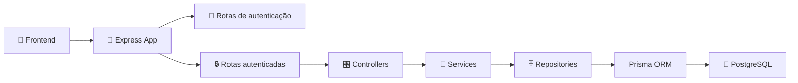
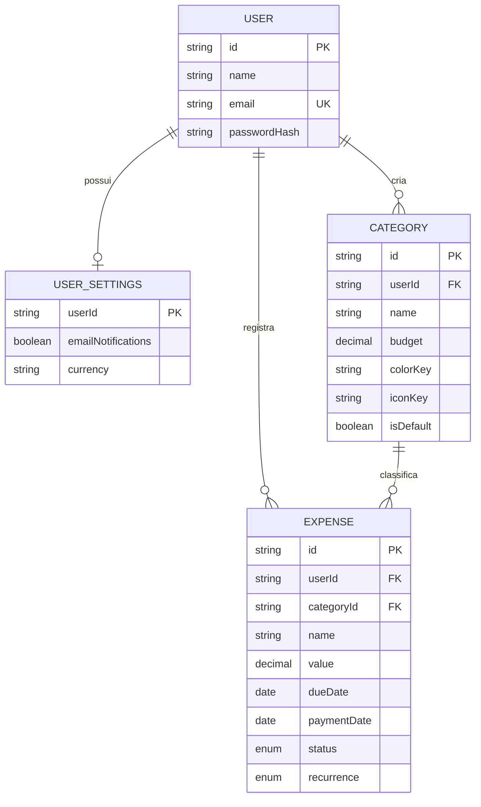

<div align="center">


</div>

<p align="center">
  
  
  
  
</p>

API REST desenvolvida para o Home Finance, responsável por autenticação, categorias,
despesas, configurações do usuário e persistência dos dados em PostgreSQL.

---

## Visão geral

O backend organiza o domínio financeiro em uma API tipada e valida as entradas HTTP
com Zod. O acesso às rotas protegidas é feito por um cookie de sessão HTTP-only,
assinado com JWT.

<table>
<tr>
<td width="50%" valign="top">

### 🔐 Autenticação segura

Cadastro e login com senhas criptografadas por bcrypt, validação de força da senha
e sessão armazenada em cookie HTTP-only.

</td>
<td width="50%" valign="top">

### 💸 Gestão de despesas

Cadastro, edição, exclusão, filtro por mês e alternância do status entre pago e
pendente.

</td>
</tr>
<tr>
<td width="50%" valign="top">

### 🗂️ Categorias

Lista categorias padrão do sistema junto das categorias disponíveis para o usuário.

</td>
<td width="50%" valign="top">

### ⚙️ Configurações

Preferências de notificações por e-mail e moeda são persistidas por usuário.

</td>
</tr>
</table>

---

## Stack

| Tecnologia | Finalidade |
|---|---|
| Node.js | Runtime da aplicação |
| Express 5 | Servidor HTTP e roteamento |
| TypeScript 7 | Tipagem estática e compilação |
| Prisma 7 | ORM, migrations e seed |
| PostgreSQL | Banco de dados |
| Zod 4 | Validação de payloads e variáveis de ambiente |
| JWT | Assinatura da sessão |
| bcryptjs | Hash seguro de senhas |
| Helmet, CORS e cookie-parser | Segurança e integração HTTP |
| express-rate-limit | Limitação de tentativas no login e cadastro |

---

## Arquitetura



Fluxo das camadas:

```text
Route -> Middleware -> Controller -> Service -> Repository -> Prisma
```

### Estrutura do projeto

```text
📦 home-finance-backend
├── 📂 prisma/
│   ├── schema.prisma       # Modelos e enums
│   ├── seed.ts             # Usuário e categorias padrão
│   └── migrations/         # Histórico de migrations
├── 📂 src/
│   ├── app.ts              # Middlewares e registro das rotas
│   ├── server.ts           # Inicialização e encerramento gracioso
│   ├── config/             # Ambiente, CORS e banco
│   ├── constants/          # Constantes do domínio
│   ├── controllers/        # Adaptadores HTTP
│   ├── errors/             # Erros da aplicação
│   ├── middlewares/        # Autenticação, validação e erros
│   ├── repositories/       # Acesso ao banco
│   ├── routes/             # Definição dos endpoints
│   ├── services/           # Regras de negócio
│   ├── types/              # Contratos TypeScript
│   ├── utils/              # JWT, senha e async handler
│   └── validators/         # Schemas Zod
├── .env.example
├── prisma.config.ts
├── package.json
└── tsconfig.json
```

---

## Pré-requisitos

- Node.js 20 ou superior
- npm
- PostgreSQL
- Frontend disponível em `http://localhost:3000` por padrão

---

## Instalação e execução

### 1. Instalar dependências

```bash
npm install
```

### 2. Configurar o ambiente

Copie o arquivo de exemplo:

```bash
cp .env.example .env
```

No Windows PowerShell:

```powershell
Copy-Item .env.example .env
```

Configure as variáveis:

| Variável | Obrigatória | Padrão no `.env.example` | Descrição |
|---|---:|---|---|
| `NODE_ENV` | Não | `development` | Ambiente: `development`, `test` ou `production` |
| `PORT` | Não | `3333` | Porta HTTP |
| `DATABASE_URL` | Sim | Local PostgreSQL | URL de conexão usada pelo Prisma |
| `JWT_SECRET` | Sim | Exemplo inseguro | Segredo JWT com 32 caracteres ou mais |
| `JWT_EXPIRES_IN` | Não | `7d` | Validade usada na geração do token |
| `CLIENT_URL` | Sim | `http://localhost:3000` | Origem autorizada pelo CORS |

> Gere um segredo próprio para ambientes não locais, por exemplo:
>
> ```bash
> node -e "console.log(require('crypto').randomBytes(48).toString('hex'))"
> ```

### 3. Preparar o banco

```bash
npm run db:generate
npm run db:migrate
npm run db:seed
```

O seed cria o usuário demo `demo@email.com` com a senha `Pass123@` e adiciona as
categorias padrão, caso ainda não existam.

### 4. Iniciar a API

```bash
npm run dev
```

A API fica disponível em `http://localhost:3333`.

Verifique o servidor:

```bash
curl http://localhost:3333/health
```

Resposta esperada:

```json
{ "status": "ok" }
```

---

## Scripts

| Comando | Descrição |
|---|---|
| `npm run dev` | Executa o servidor em modo watch |
| `npm run build` | Compila TypeScript para `dist/` |
| `npm run start` | Executa a build compilada |
| `npm run typecheck` | Verifica tipos sem gerar arquivos |
| `npm run db:generate` | Gera o cliente Prisma |
| `npm run db:migrate` | Cria/aplica migrations em desenvolvimento |
| `npm run db:deploy` | Aplica migrations em produção |
| `npm run db:seed` | Executa o seed |
| `npm run db:studio` | Abre o Prisma Studio |

---

## API Reference

Todas as rotas estão agrupadas sob `/api`. Exceto registro e login, as rotas
protegidas exigem o cookie `hf_session`.

### Health check

| Método | Rota | Autenticação | Resposta |
|---|---|---|---|
| `GET` | `/health` | Não | `200 { "status": "ok" }` |

### Autenticação

| Método | Rota | Descrição | Resposta |
|---|---|---|---|
| `POST` | `/api/auth/register` | Cria uma conta | `201` com usuário |
| `POST` | `/api/auth/login` | Autentica e cria o cookie de sessão | `201` com usuário |
| `POST` | `/api/auth/logout` | Remove o cookie de sessão | `204` |
| `GET` | `/api/auth/me` | Retorna o usuário da sessão | `200` |

#### Registro

```http
POST /api/auth/register
Content-Type: application/json

{
  "name": "Maria Silva",
  "email": "maria@example.com",
  "password": "Senha123!"
}
```

Requisitos da senha:

- mínimo de 8 caracteres;
- pelo menos uma letra maiúscula;
- pelo menos um número;
- pelo menos um símbolo especial.

#### Login

```http
POST /api/auth/login
Content-Type: application/json

{
  "email": "maria@example.com",
  "password": "Senha123!"
}
```

As tentativas de login e registro possuem rate limit de 10 requisições por
janela de 15 minutos.

### Despesas

Todas as rotas desta seção exigem autenticação.

| Método | Rota | Descrição | Resposta |
|---|---|---|---|
| `GET` | `/api/expenses` | Lista despesas do usuário | `200` |
| `GET` | `/api/expenses?month=2026-11` | Lista despesas de um mês | `200` |
| `POST` | `/api/expenses` | Cria uma despesa | `201` |
| `PUT` | `/api/expenses/:id` | Atualiza uma despesa | `200` |
| `PATCH` | `/api/expenses/:id/toggle-paid` | Alterna pago/pendente | `200` |
| `DELETE` | `/api/expenses/:id` | Remove uma despesa | `204` |

#### Criar despesa

```http
POST /api/expenses
Content-Type: application/json
Cookie: hf_session=<jwt>

{
  "name": "Aluguel",
  "description": "Aluguel mensal",
  "categoryId": "<category-id>",
  "value": 1800,
  "dueDate": "2026-11-10",
  "paymentDate": null,
  "status": "PENDING",
  "recurrence": "MONTHLY"
}
```

Campos aceitos:

| Campo | Tipo | Validação |
|---|---|---|
| `name` | `string` | Obrigatório |
| `description` | `string \| null` | Máximo de 500 caracteres |
| `categoryId` | `string` | Obrigatório e pertencente ao usuário ou padrão |
| `value` | `number` | Maior que zero |
| `dueDate` | `YYYY-MM-DD` | Obrigatório |
| `paymentDate` | `YYYY-MM-DD \| null` | Opcional |
| `status` | `PAID \| PENDING` | Obrigatório |
| `recurrence` | `ONCE \| WEEKLY \| MONTHLY \| YEARLY` | Padrão: `ONCE` |

### Categorias

| Método | Rota | Descrição | Resposta |
|---|---|---|---|
| `GET` | `/api/categories` | Lista categorias padrão e disponíveis ao usuário | `200` |

### Configurações

| Método | Rota | Descrição | Resposta |
|---|---|---|---|
| `GET` | `/api/settings` | Retorna as preferências do usuário | `200` |
| `PUT` | `/api/settings` | Cria ou atualiza as preferências | `200` |

```http
PUT /api/settings
Content-Type: application/json
Cookie: hf_session=<jwt>

{
  "emailNotifications": true,
  "currency": "BRL"
}
```

---

## Modelo de dados

O Prisma gerencia quatro entidades principais:



Enums disponíveis:

```text
ExpensStatus: PAID | PENDING
Recurrence: ONCE | WEEKLY | MONTHLY | YEARLY
```

> O nome `ExpensStatus` é uma definição existente no schema Prisma.

---

## Segurança

- cookies HTTP-only com `sameSite=lax`;
- cookie marcado como `secure` em produção;
- segredo JWT validado em ambiente com mínimo de 32 caracteres;
- senha armazenada como hash bcrypt;
- CORS restrito a `CLIENT_URL`;
- cabeçalhos HTTP reforçados pelo Helmet;
- payload JSON limitado a 100 KB;
- validação de entrada com Zod;
- verificação de propriedade de despesas e categorias;
- rate limit em login e registro;
- encerramento gracioso com desconexão do Prisma.

Em produção, configure um segredo forte e use HTTPS para que o cookie seguro seja
transportado corretamente.

---

## Respostas de erro

Erros da aplicação seguem o formato:

```json
{
  "message": "Dados inválidos",
  "details": [
    {
      "field": "email",
      "message": "E-mail inválido"
    }
  ]
}
```

| Status | Situação |
|---|---|
| `400` | Dados inválidos |
| `401` | Cookie ausente, JWT inválido ou credenciais incorretas |
| `404` | Recurso ou rota inexistente |
| `409` | Registro duplicado |
| `500` | Erro interno do servidor |

---

## Produção

1. Defina `NODE_ENV=production`.
2. Configure `DATABASE_URL` apontando para o banco de produção.
3. Configure `JWT_SECRET` com um segredo forte.
4. Configure `CLIENT_URL` com a origem real do frontend.
5. Gere a build e aplique as migrations:

```bash
npm run db:generate
npm run db:deploy
npm run build
npm run start
```

---

## Qualidade do projeto

| Categoria | Status |
|---|---|
| TypeScript strict | Configurado |
| Verificação de tipos | `npm run typecheck` |
| Testes automatizados | Ainda não configurados no diretório do backend |
| CI/CD | Nenhum workflow encontrado |
| Cobertura | Ainda não configurada |

---

## Licença

O diretório do backend não possui um arquivo `LICENSE` próprio. Ele faz parte do
projeto principal, cuja licença MIT está definida em [LICENSE](../home-finance/LICENSE).

Observação: o campo `license` no `package.json` deste backend está definido como
`ISC`; a licença efetiva do repositório principal permanece MIT.

---

<div align="center">

Desenvolvido para o **Home Finance**

</div>
